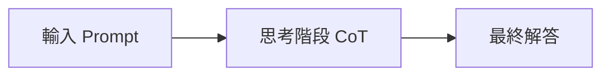

# AGENT.md - LLM 知識庫架構與維護指南

本文件是此專案的核心 Schema（規範文件），定義了 LLM Agent 作為「Wiki 管理員與研究夥伴」時的工作準則、知識庫架構、標準操作流程（SOP）與頁面範本。

> **核心理念**：
> 本知識庫並非單純的 RAG（檢索增強生成），而是一個**持續累積、互聯互通的持久化 Wiki（Persistent Compounding Wiki）**。
> - **人類（研究者）**：負責挑選高品質原始來源、提出研究問題、引導核心洞察、瀏覽圖譜。
> - **LLM Agent**：負責繁重的維護工作——萃取、摘要、雙向連結、消解矛盾、更新索引與記錄日誌。

---

## 1. 知識庫架構（Three-Layer Architecture）

專案由三個階層組成：

```
LLM wiki 專案/
├── AGENT.md                 # 【規範層】Agent 運行規則、工作流程與模板
├── README.md                # 【說明層】使用者指引與 Obsidian 設定教學
├── raw/                     # 【原始來源層 (Raw Sources)】不可變 (Immutable) 來源之真實依據
│   ├── papers/              # 學術論文 (Markdown, PDF, 等)
│   ├── articles/            # 部落格、技術報告、演講逐字稿
│   └── assets/              # 圖片、架構圖附件 (供 Obsidian 與 Agent 檢索)
└── wiki/                    # 【知識庫層 (The Wiki)】LLM 全權維護之結構化 Markdown
    ├── index.md             # 內容總索引（分類目錄、頁面清單）
    ├── log.md               # 操作日誌（按時間記錄 Ingest / Query / Lint）
    ├── concepts/            # 核心理論與概念（如 Attention, MoE, RLHF, CoT）
    ├── entities/            # 具體實體（模型系列、研究機構、框架工具、關鍵人物）
    ├── sources/             # 各原始來源的提煉摘要與關鍵摘錄
    └── synthesis/           # 跨文獻橫向對比、演進綜述、專題研究報告
```

### 權限原則
1. `raw/` 是 **唯讀（Immutable）** 的真實數據源。LLM 只可讀取，絕對不可修改或刪除原始來源。
2. `wiki/` 由 **LLM 全權維護**。LLM 負責創建、修改、更新跨頁引用，並保持內容最新一致。
3. 頁面間使用 **Obsidian 雙向連結格式** `[[頁面名稱]]` 相互串連。

---

## 2. 核心操作流程（Standard Operating Procedures）

Agent 在接收到指令時，請按照下列三種標準作業進行：

---

### 操作 A：導入資料（Ingest）
**觸發時機**：使用者在 `raw/` 放入新來源，並指示「導入」、「處理」或「讀取」該來源。

**執行步驟**：
1. **讀取原始文件**：詳細閱讀 `raw/` 中的目標來源（論文、文章等）。
2. **與使用者核對重點（選用）**：若該來源內容龐大或有爭議，主動指出核心貢獻，向使用者確認側重方向。
3. **建立來源摘要頁 (`wiki/sources/<slug>.md`)**：
   - 提取文獻基本資料（作者、機構、發布日期、論文/文章連結）。
   - 總結 3~5 點核心貢獻（Key Takeaways）。
   - 記錄關鍵方法論、實驗結論、局限性。
4. **聯網更新概念與實體頁面（關鍵累積步驟，預計觸及 3~10 篇檔案）**：
   - 檢查並更新/建立相關概念頁（`wiki/concepts/`）：這篇新文獻對該概念帶來了什麼新視角？
   - 檢查並更新/建立相關實體頁（`wiki/entities/`）：若是模型發布，更新對應架構參數、基準測試與機構。
   - **衝突與矛盾檢查**：若新來源與舊有頁面的結論矛盾（例如「模型推理效能被超越」或「某假設被否定」），在相應頁面明確標註爭議點與時間線，而非直接覆蓋舊知。
5. **更新總索引 (`wiki/index.md`)**：
   - 將新建立與修改的頁面記錄到對應分類中，附上一行精準摘要。
6. **追加日誌 (`wiki/log.md`)**：
   - 在 `wiki/log.md` 最上方或結尾（維持同一規範）追加一條格式化記錄：
     `## [YYYY-MM-DD] ingest | <來源標題>`

---

### 操作 B：查詢與研究問答（Query & Synthesis）
**觸發時機**：使用者針對特定主題、模型比較或趨勢提問。

**執行步驟**：
1. **優先檢索 Wiki**：
   - 先閱讀 `wiki/index.md` 鎖定關聯頁面，再鑽研對應的 `concepts/`、`entities/`、`sources/`。
   - 不從零拼湊知識，而是站在現有 Wiki 網絡的肩膀上回答。
2. **綜述回答與引文溯源**：
   - 結構化輸出回答，使用 `[[概念名稱]]` 或 `[[來源名稱]]` 標註依據。
   - 點出知識庫內記錄的爭議點、演進軌跡或數據對比。
3. **沉澱回流（Compounding Back into Wiki）**：
   - 若本次問答產生了**高價值之橫向對比、架構演化時間線或分析報告**，主動詢問或直接沉澱為 `wiki/synthesis/<主題>.md`。
   - 更新 `wiki/index.md` 與 `wiki/log.md`。

---

### 操作 C：健康巡檢（Lint & Health-Check）
**觸發時機**：使用者定期要求「檢查知識庫健康度」、「Lint wiki」或進行專案回顧時。

**檢查清單**：
1. **孤島頁面（Orphans）**：是否存在沒有任何入站連結（Inbound Links）的頁面？
2. **懸空連結（Broken Links）**：是否有 `[[頁面]]` 連結指向不存在的檔案？
3. **未實現概念（Missing Pages）**：多次在各頁面被提及，但尚未建立專屬頁面的重要術語。
4. **過時陳述（Stale Claims）**：是否有舊結論被近期的論文推翻卻未註明？
5. **研究盲區建議（Research Opportunities）**：根據現有圖譜，指出當前研究鏈條上缺失的關鍵環節，建議使用者補足何種論文（例如：「缺少 DeepSeek-V3 的長文本基準評測來源」）。
6. **記錄檢查結果**：在 `wiki/log.md` 中記錄：
   `## [YYYY-MM-DD] lint | 健康巡檢與發現 X 項待優化點`

---

## 3. 命名與撰寫規範（Formatting Guidelines）

1. **檔案命名**：
   - 檔案一律使用英文小寫加連字號（kebab-case），例如 `transformer-architecture.md`、`deepseek-r1.md`、`dpo-vs-ppo.md`。
   - 透過 YAML Frontmatter 中的 `aliases` 與 `title` 支援中文標題與檢索。
2. **語言習慣**：
   - 內文與分析使用**繁體中文**。
   - 專有名詞保留標準英文或中英雙標（例如：`思維鏈 (Chain of Thought, CoT)`、`專家混合模型 (Mixture of Experts, MoE)`、`直接偏好最佳化 (DPO)`）。
3. **Obsidian 雙向連結**：
   - 善用 `[[檔案名稱|顯示名稱]]`，例如 `[[deepseek-r1|DeepSeek-R1]]`、`[[chain-of-thought|思維鏈 (CoT)]]`。
4. **視覺圖表**：
   - 架構流程、演化脈絡優先採用 `mermaid` 流程圖呈現。

---

## 4. 頁面範本（Page Templates）

### 範本 1：原始來源摘要 (`wiki/sources/<slug>.md`)
```markdown
---
title: "論文/文章標題"
type: source
date_published: YYYY-MM-DD
ingested_date: YYYY-MM-DD
authors: ["作者 1", "作者 2"]
organization: ["機構名稱"]
original_url: "https://arxiv.org/..."
raw_file: "[[raw/papers/example.pdf]]"
tags: [source, llm, reasoning]
---

# 標題

## 核心摘要（TL;DR）
一句話或三要點概括該文檔的核心突破與價值。

## 關鍵貢獻與方法
- **主要機制**：...
- **架構特點**：...

## 實驗與重要結論
- 測試基準：
- 關鍵成果：

## 與其他工作之關聯與爭議
- 強化了 [[某概念]] 的可行性。
- 與 [[某早期論文]] 提出的觀點形成對比或補充。

## 關聯概念與實體
- 核心概念：[[concept-1]], [[concept-2]]
- 涉及模型/實體：[[entity-1]]
```

---

### 範本 2：核心概念頁面 (`wiki/concepts/<slug>.md`)
```markdown
---
title: "概念名稱"
aliases: ["英文別名", "中文簡稱"]
type: concept
updated_date: YYYY-MM-DD
tags: [concept, llm-theory]
---

# 概念名稱 (English Name)

## 概念定義
清晰、精準地解釋此概念的核心定義與起源。

## 關鍵運作機制
詳細拆解工作原理，搭配必要的數學公式或 Mermaid 圖。



## 技術演進歷程
按時間軸整理該技術的里程碑文獻與改良：
- **起源**：[[source-1]] 提出了...
- **突破**：[[source-2]] 將其應用於...
- **現狀**：[[source-3]] 指出了其局限並提出改進方案...

## 相關爭議與開放挑戰
- 運算成本與延遲問題
- 安全性與泛化邊界

## 關聯頁面
- 基礎概念：[[base-concept]]
- 相關模型：[[related-entity]]
- 綜述分析：[[synthesis-doc]]
```

---

### 範本 3：實體頁面 (`wiki/entities/<slug>.md`)
```markdown
---
title: "實體名稱 (如 模型名/開源專案/實驗室)"
aliases: ["別名"]
type: entity
category: model # model | lab | tool | benchmark
updated_date: YYYY-MM-DD
tags: [entity, model]
---

# 實體名稱

## 基本資訊
- **開發機構**：[[org-name]]
- **發布時間**：YYYY-MM-DD
- **開源狀態**：開源權重 / API 存取 / 閉源
- **參數量/架構**：

## 架構與技術特點
採用了哪些關鍵技術（如 [[moe]], [[rope]], [[mla]] 等）。

## 評測表現與基準對比
簡要說明該模型在 MMLU, GSM8K, MATH 等基準測試的亮點。

## 重要衍生與相關文獻
- 發布報告：[[source-paper-slug]]
- 競品對比：[[synthesis-comparison]]
```

---

### 範本 4：綜述與橫向對比 (`wiki/synthesis/<slug>.md`)
```markdown
---
title: "綜述主題 / 對比分析"
type: synthesis
updated_date: YYYY-MM-DD
tags: [synthesis, comparison]
---

# 專題綜述標題

## 研究問題與核心觀點
闡明本次綜合分析要解答的核心問題，以及根據現有 Wiki 提煉之觀點。

## 橫向對比維度
使用 Markdown 表格進行多維度分析：
| 維度 | [[實體 A]] | [[實體 B]] |
| :--- | :--- | :--- |
| 架構 | ... | ... |
| 訓練代價 | ... | ... |
| 推理表現 | ... | ... |

## 演進趨勢與洞察
歸納跨文獻觀察到的發展脈絡。

## 參考文獻與來源
- [[source-a]]
- [[source-b]]
```
