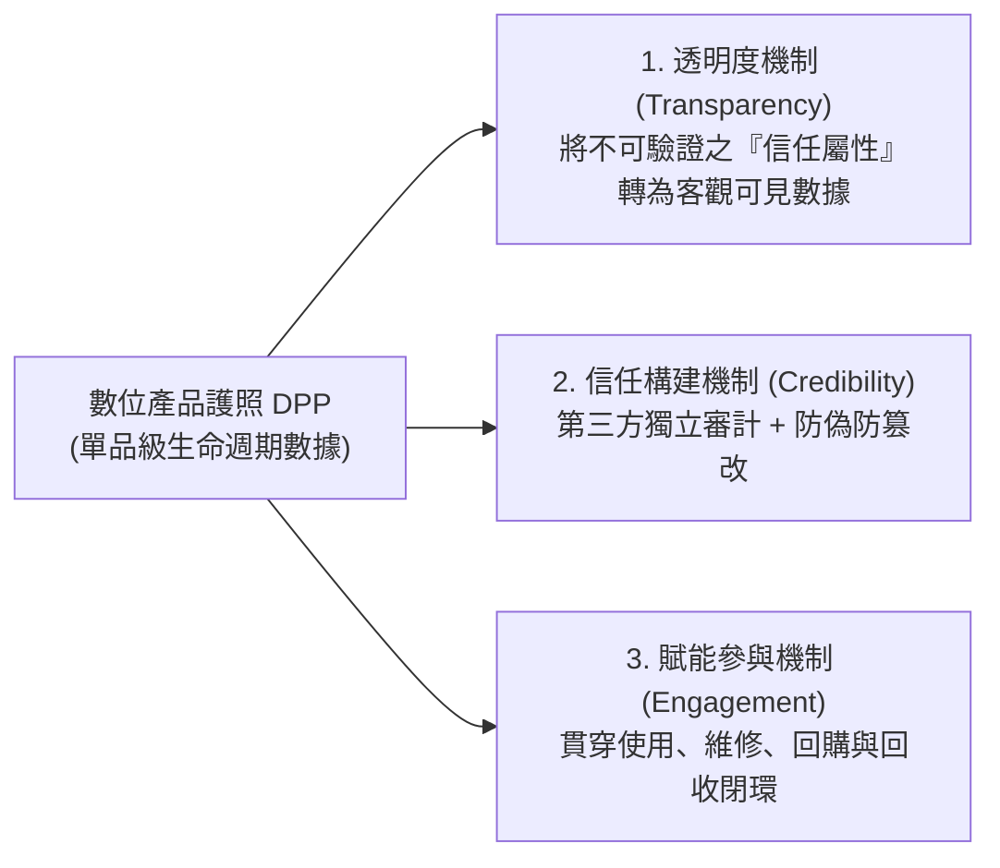

# 研究筆記：數位產品護照 (DPP) 在永續行銷與循環經濟中的機制與競爭優勢

> **【嚴格聲明】**
> 本筆記主體內容 **100% 嚴格依據本 Wiki 知識庫現有文獻**（詳見文內 `[[雙向鏈接]]`）整理而成，不摻雜未經 Wiki 沉澱的外部推測。
> 文末附有**聯網搜尋建議之延伸參考文獻**（附有一鍵下載 PDF 直達連結），供後續進行 Wiki 化 Ingest 擴充。

---

## 一、 研究背景與市場失靈的核心癥結

在現代消費市場中，消費者對產品環保、減碳與勞動倫理的重視與日俱增。然而，根據 [[signaling-theory-sustainability|永續訊號理論與信任屬性]]，永續性本質上屬於 Nelson (1970) 與 Darby & Karni (1973) 所定義的**「信任屬性 (Credence Attributes)」**：
- **搜尋屬性 (Search)**：購買前可檢驗（如顏色、重量）；
- **體驗屬性 (Experience)**：購買與使用後可檢驗（如口感、電池續航）；
- **信任屬性 (Credence)**：**即使消費者購買並使用完畢，依然完全無法自行查證**（例如：原料是否 100% 來自人道勞動？是否真正採用再生綠電？回收率是否如宣稱？）。

### 逆向選擇（Adverse Selection）與漂綠氾濫
由於買賣雙方存在嚴重的資訊不對稱，市場容易陷入阿克洛夫（Akerlof, 1978）的檸檬市場陷阱。消費者因無法分辨真偽，理性上會對市場上所有宣稱「綠色」的產品採取**無差別心理折價**：

$$\mathbb{E}[V] = q \cdot V_{\text{Green}} + (1 - q) \cdot V_{\text{Fake}}$$

其中 $q$ 為市場上真實環保產品的比例。當市場上充斥廉價的「漂綠（Greenwashing）」行銷宣傳時，真實投入高昂成本進行減碳製程的企業无法獲得相應回報，被迫退出市場，造成劣幣逐良幣。

---

## 二、 數位產品護照 (DPP) 的理論化重構

過去學界多將 [[digital-product-passport|數位產品護照 (DPP)]] 視為供應鏈工程（SCM）與底層區塊鏈追溯技術。根據本庫文獻 [[source-koukopoulos-lazaris-2026-dpp|Koukopoulos & Lazaris (2026)]]，DPP 的真正戰略價值在於其在**需求端（Demand-side）與永續行銷上的訊號革命**。

### 1. DPP 的三大作用機制

1. **透明度機制 (Transparency Mechanism)**：將全生命週期數據（碳足跡、材料成分、供應商產地）結構化公開，把不可查證的「信任屬性」直接轉化為「可檢驗數據」。
2. **信任構建機制 (Credibility Mechanism)**：借助歐盟法規強制作為背書，並以獨立第三方確信排除隨意偽造，有效消除消費者對漂綠的防衛心理。
3. **賦能參與機制 (Engagement Mechanism)**：打破傳統行銷在「購買結帳」即告終止的局限，將消費關係延伸至使用期（維修指南、保固、零件更換）與廢棄期（逆向物流、回購、材質拆解），實現 [[value-creation-and-capture|價值共創]]。

### 2. 訊號理論視角：分離均衡的數學條件
Spence (1973) 的訊號理論指出，只有當「發送訊號的邊際成本對不同類型企業存在顯著差異」時，訊號才能形成**分離均衡（Separating Equilibrium）**：

設：
- $C_G$ 為真實永續企業（Green）建置並通過審計的 DPP 成本；
- $C_F$ 為漂綠/偽劣企業（Fake）試圖合規 DPP 的成本（包含供應鏈改造代價與法規造假處罰期望值）；
- $\Delta P = P_G - P_F$ 為市場消費者願意為真實環保產品支付的溢價（WTP Premium）。

分離均衡成立的充要條件為：
$$C_G < \Delta P < C_F$$

- 對真實環保企業：$C_G < \Delta P$，發送經審計的 DPP 是正期望回報；
- 對漂綠企業：$C_F > \Delta P$，試圖偽造生命週期審計代價過高，迫使其放棄假冒，市場真偽企業自然分離。

> **【主邊界條件（Master Boundary Condition）】**：
> 單純依靠區塊鏈等分散式帳本僅能保證「上鏈後不可竄改」，無法防止「源頭輸入造假」。因此，**DPP 能否成為有效訊號，完全取決於是否存在獨立第三方審計與數據確信（Independent Assurance）**。若缺乏審計，DPP 反而會成為新型態漂綠的遮羞布。

---

## 三、 六大核心行銷與競爭優勢命題 (P1 ~ P6 整合)

根據 [[source-koukopoulos-lazaris-2026-dpp|Koukopoulos & Lazaris (2026)]]，DPP 在永續行銷與企業策略層面推導出 6 大結構化命題：

| 編號 | 核心命題內容 | 理論基礎 | 關鍵調節變數 (Moderators) |
| :--- | :--- | :--- | :--- |
| **P1** | 經獨立驗證之 DPP 能顯著降低消費者漂綠認知，提高品牌誠信度。 | 訊號理論 (Spence) | 資訊易讀性 (Usability)；環境衝擊敏感度高之產品效果更強。 |
| **P2** | 經審計之 DPP 公信力能顯著提升消費者**支付溢價意願 (WTP)** 與購買意向。 | 理性行為理論 (Fishbein & Ajzen) | 消費者過往對綠色宣傳之懷疑度 (Prior Scepticism)；產品核心價值主張。 |
| **P3** | DPP 賦予消費者產品知識，能有效激發使用期維修、二手再利用與廢棄回收之循環行為。 | 資訊賦能 (Empowerment) | 介面引導友善度；用戶對永續議題之先驗興趣。 |
| **P4** | 長期互動促成企業與顧客間的**價值共創 (Value Co-creation)**，顯著提升品牌忠誠與口碑倡導。 | 服務主導邏輯 (Vargo & Lusch 2004) | 平台參與便利性；顧客從參與中獲得之成就認同感。 |
| **P5** | DPP 互動產生的單品級行為軌跡，使企業得以進行極致**精準的綠色市場分群**。 | 行為數據分析 (Behavioral Analytics) | 隱私授權與個資防護 (Privacy Safeguards)；企業數據分析能力。 |
| **P6** | **競爭優勢呈現法規演變兩階段性**：自願期以「透明度領袖」獲取先發優勢；強制期全員皆具 DPP，優勢轉向「超越法規最低門檻（Beyond-Compliance）」與「數據驗證等級」。 | 動態競爭與法規成熟度模型 | 法規強制推進速度（如歐盟 ESPR 電池與紡織法規推進時程）。 |

---

## 四、 與商業模式 (Business Model) 的交織應用

結合本庫 [[business-model|商業模式]]、[[activity-system|活動系統觀點]] 與 [[value-creation-and-capture|NICE 價值驅動模型]]，DPP 實質上重構了企業的跨邊界活動架構：
1. **Novelty (新穎性)**：跳脫傳統一次性買斷，以 DPP 串連租賃、回收押金制與再製造循環模式；
2. **Lock-in (鎖定效應)**：以單品 DPP 為數位入口，鎖定消費者之後續維修、配件購買與舊機折抵回購；
3. **Complementarities (互補性)**：串聯第三方維修技師、回收處理廠與二手轉售平台，形成互補共贏生態；
4. **Efficiency (效率性)**：標準化數位介面大幅消除供應鏈資訊斷層，符合全局系統最佳化（Third-order Fit）。

---

## 五、 建議延伸閱讀與 Wiki 待 Ingest 文獻候選 (外網檢索)

以下文獻為透過學術檢索整理之最新 DPP 前沿研究，**目前尚未收錄於本庫**。每篇均附上**一鍵直接下載 PDF** 或官方直達連結，點擊後可下載並放入 `raw/papers/`，啟動下一輪 Wiki Ingest SOP：

1. **歐盟永續產品生態設計法規官方全文 (Regulation (EU) 2024/1781 - ESPR)**
   - **作者/機構**：European Parliament & Council of the European Union (2024)
   - **核心價值**：歐盟 DPP 最核心之母法法律依據，規定了 2024~2030 年各產業分階段強制導入時程與數位註冊庫標準。
   - **[📄 點此直接下載官方 PDF 全文](https://eur-lex.europa.eu/legal-content/EN/TXT/PDF/?uri=CELEX:32024R1781)** ｜ [🔗 歐盟 EUR-Lex 法規條文頁面](https://eur-lex.europa.eu/eli/reg/2024/1781/oj/eng)

2. **《Digital Product Passports: An Information Systems Perspective》**
   - **作者**：Petrik, D. et al. (2026)
   - **刊物**：*Electronic Markets* (Springer Open Access)
   - **核心價值**：從資訊系統與跨組織治理維度系統梳理 DPP 設計模式、數據共享阻礙與組織邊界跨越機制。
   - **[📄 點此直接下載開源 PDF 論文](https://link.springer.com/content/pdf/10.1007/s12525-025-00789-x.pdf)** ｜ [🔗 Springer 官方頁面 (DOI: 10.1007/s12525-025-00789-x)](https://doi.org/10.1007/s12525-025-00789-x)

3. **《Digital battery passports to enable circular and sustainable value chains: Conceptualization and use cases》**
   - **作者**：Berger, K., Schöggl, J.-P., & Baumgartner, R. J. (2022)
   - **刊物**：*Journal of Cleaner Production*
   - **核心價值**：首部探討歐盟電池法規（Battery Passport）具體案例與循環供應鏈數據規格之標竿文獻。
   - **[🔗 ScienceDirect / DOI 直達連結](https://doi.org/10.1016/j.jclepro.2022.131492)**

4. **《Digital Product Passports: Use Cases Framework and Technical Architecture using DLT and Smart Contracts》**
   - **作者**：Nowacki, S., Sisik, G. M., & Angelopoulos, C. M. (2023)
   - **刊物**：IEEE DCOSS-IoT
   - **核心價值**：詳解基於分散式帳本技術 (DLT) 與智能合約之 DPP 系統底層架構，分析鏈上防偽與隱私權保護機制。
   - **[🔗 IEEE Xplore / DOI 直達連結](https://doi.org/10.1109/DCOSS-IoT58021.2023.00067)**
