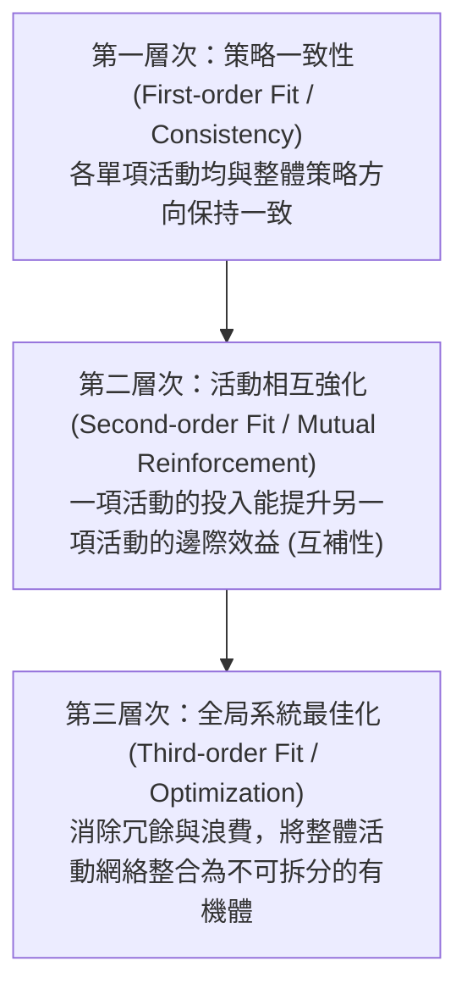

# 活動系統觀點 (Activity System Perspective)

## 概念定義
**活動系統觀點 (Activity System Perspective)** 將企業視為一套由多項具體組織活動（Activities）緊密交織、相互依存的複雜系統。

在 [[source-zott-amit-massa-2010-business-model|Zott, Amit & Massa (2010)]] 的文獻綜述中，活動系統被確立為商業模式最紮實的理論載體之一。企業的競爭優勢並非源於單一資源或單項能力，而是來自於**整套活動系統的獨特性與協同契合度（Fit）**。

---

## 活動配適度（Fit）的三個層次
邁克爾·波特（Porter, 1996）與 Milgrom & Roberts (1990, 1995) 提出了活動系統內部契合的三種層級：

1. **第一層次：活動與策略的一致性 (Consistency)**：各項活動（研發、行銷、物流、客服）皆圍繞相同的價值主張運作，不互相抵銷。
2. **第二層次：活動之間的互補與相互增強 (Mutual Reinforcement)**：一項活動的進行大幅提升了其他活動的效率（例如：西南航空的單一機型機隊降低了飛行員培訓成本，同時加速了地勤調度）。
3. **第三層次：全局最佳化 (Global Optimization)**：超越單純強化，實現資訊交換與流程的高度無縫對接，使競爭對手難以透過單點模仿（Cherry-picking）來複製。

---

## 活動系統在商業模式中的角色
1. **跨越邊界（Boundary-spanning）**：
   傳統價值鏈（Porter, 1985）主要檢視企業內部的線性流動。而現代商業模式的活動系統，則將**供應商、外部外包商、平台開發者與最終用戶**所執行的活動全部納入考量。
2. **設計維度（Design Parameters - Zott & Amit, 2010）**：
   - **內容 (Content)**：執行了哪些具體活動？
   - **結構 (Structure)**：這些活動如何相互串接與排序？
   - **治理 (Governance)**：各活動由誰來執行（企業內部、合作夥伴、還是用戶社群）？

---

## 關聯頁面
- 核心理論：[[business-model|商業模式]]、[[value-creation-and-capture|價值創造與價值捕獲]]
- 來源文獻：[[source-zott-amit-massa-2010-business-model]]
- 相關概念：[[business-model-innovation|商業模式創新]]
