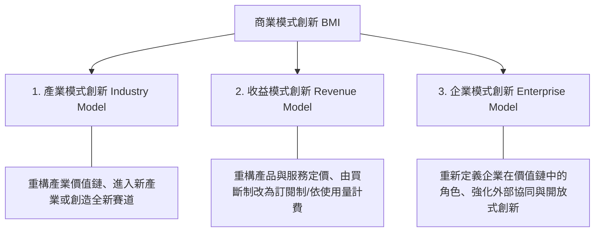

# 商業模式創新 (Business Model Innovation, BMI)

## 概念定義
**商業模式創新 (Business Model Innovation, BMI)** 指企業透過對其價值主張、活動系統配置、夥伴網絡或收入機制的根本性重塑，以創造並捕獲全新市場價值的變革過程。

它不同於傳統的「產品創新」（如研發更快的晶片）或「流程創新」（如引進六標準差），而是改變企業整體的**運作邏輯與價值網絡生態**。

---

## 商業模式創新的三大類型（IBM / Giesen et al., 2007）
根據 IBM 全球 CEO 研究調查，財務表現卓越的企業在商業模式創新上的投入是落後者的兩倍。BMI 主要分為三種類型：

---

## 既有企業（Incumbent）推行 BMI 的兩大阻礙
根據 [[source-zott-amit-massa-2010-business-model|Zott, Amit & Massa (2010)]] 與 Chesbrough (2010)，成熟企業在面對新技術典範時往往無法轉型，主要來自兩重結構性障礙：

1. **資產與營運流程慣性 (Asset Inertia)**：
   既有企業擁有龐大的重型固定資產、成熟的專利庫與專門化的營運流程。新商業模式往往會蠶食（Cannibalize）現有產品線的利潤，招致內部既得利益阻力。
2. **認知與主導邏輯陷阱 (Dominant Logic Trap & Identity Trap)**：
   - **主導邏輯 (Prahalad & Bettis, 1986)**：管理團隊過去賴以成功的思維慣性，會像過濾器一樣，主動忽略任何不符合現行商業模式的新技術機會（例如全錄 PARC 發明了個人電腦與圖形介面，卻因主導邏輯仍是「大型影印機租賃與耗材」而將其棄之不顧）。
   - **身分認同陷阱 (Bouchikhi & Kimberly, 2003)**：「我們是做 X 的公司」的組織身分認知，強烈限制了策略選項。

---

## 突破阻礙的關鍵機制
- **發現導向實驗 (Discovery-driven Experimentation - McGrath, 2010)**：不追求一開始就制定完美計畫，而是透過小步快跑的假設檢驗與原型試錯逐步收斂最佳模式。
- **組織敏捷度 (Strategic Agility - Doz & Kosonen, 2010)**：具備三大元能力（Meta-capabilities）：
  1. **策略敏銳度 (Strategic Sensitivity)**：能即時感知外在環境劇變；
  2. **領導層團結 (Leadership Unity)**：高管團隊勇於做出艱難取捨並承擔轉型風險；
  3. **資源彈性 (Resource Flexibility)**：能夠迅速在不同事業部間重配核心資本與人才。

---

## 關聯頁面
- 基礎概念：[[business-model|商業模式]]、[[activity-system|活動系統觀點]]
- 文獻依據：[[source-zott-amit-massa-2010-business-model]]
- 綜述比較：[[business-model-vs-strategy|商業模式 vs 競爭策略 vs 技術創新]]
