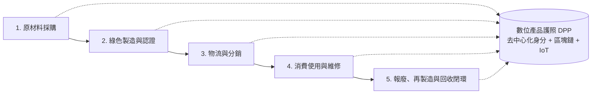

# 數位產品護照 (Digital Product Passport, DPP)

## 概念定義
**數位產品護照 (Digital Product Passport, DPP)** 是歐盟《歐洲綠色新政》與《循環經濟行動計畫》推動下的核心法規與數位資訊工具。它為每一件實體產品建立單品級（Item-level）的數位身分檔案，結構化記錄其從原材料開採、生產製造、物流分銷、使用維護到報廢回收的**全生命週期數據**。

---

## 核心法規脈絡（歐盟標準）
1. **永續產品生態設計法規 (ESPR - Regulation (EU) 2024/1781)**：確立了 DPP 作為歐盟全產業通用法規框架，設定產品耐用性、可修復性、可回收性與碳足跡標準。
2. **首波強制執行產業**：
   - **電池法規 (Batteries Regulation (EU) 2023/1542)**：首部具備法律約束力的產品別專屬規範（動力電池護照）。
   - **後續優先產業**：紡織品（Textiles）、消費電子與資通訊產品（Electronics & ICT）。

---

## 技術基礎架構
- **標識載體**：QR Code、RFID、NFC 晶片。
- **數據完整性與存取**：分散式帳本技術 (DLT / Blockchain)、物聯網 (IoT)、開放互操作性 API 標準。
- **邊界限制（Verification Boundary）**：
  技術本身（如區塊鏈）僅能確保「上鏈後不可篡改」，無法保證「初始輸入數據的真實性」。因此，DPP 的權威性高度取決於**獨立第三方法規審計與數據確信（Independent Assurance）**。

---

## 關聯頁面
- 理論基礎：[[signaling-theory-sustainability|永續訊號理論與信任屬性]]、[[sustainable-marketing-circular-economy|永續行銷與循環經濟]]
- 商業應用：[[business-model|商業模式]]、[[business-model-innovation|商業模式創新]]
- 來源文獻：[[source-koukopoulos-lazaris-2026-dpp]]
