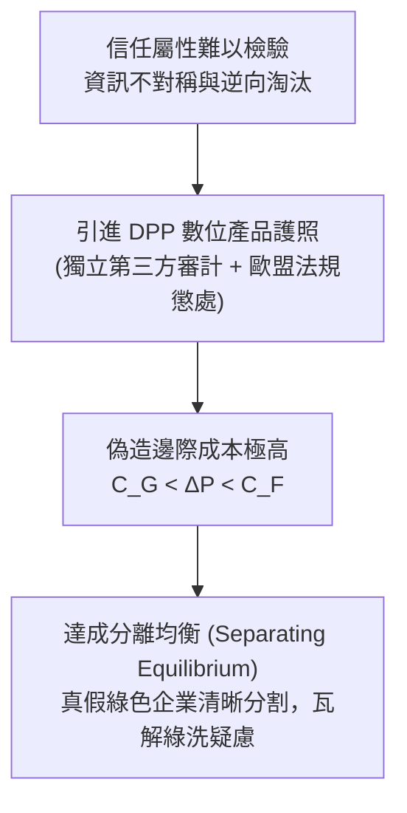

# 永續訊號理論與信任屬性 (Signaling Theory in Sustainability)

## 概念定義
在資訊經濟學中，產品屬性分為三類（Nelson 1970; Darby & Karni 1973）：
1. **搜尋屬性 (Search Attributes)**：消費者在購買前即可透過檢視得知（如產品顏色、規格）。
2. **體驗屬性 (Experience Attributes)**：購買與使用後方能驗證（如食物口感、耳機音質）。
3. **信任屬性 (Credence Attributes)**：**即使購買並長期使用後，消費者依然完全無法自行驗證**（例如：產品是否使用 100% 綠電生產、原料是否來自無童工公平貿易、是否符合真正可生物降解）。

因為永續性是典型的**信任屬性**，買賣雙方資訊極度不對稱，市場容易陷入阿克洛夫（Akerlof, 1978）的「檸檬市場（Lemons Market）」：劣幣逐良幣，消費者因懷疑「漂綠（Greenwashing）」而對所有環保產品進行折價，導致真正投入高昂成本進行環保製程的企業蒙受損失。

---

## 訊號機制與數學原理
根據 Spence (1973) 與 Connelly et al. (2011) 的訊號理論，若要讓市場達成**分離均衡（Separating Equilibrium）**，訊號必須具備**高偽造代價（Costly to Fake）**。

設真實永續企業為 $G$（Green），漂綠企業為 $F$（Fake）。
企業發送合規 DPP 訊號的成本分別為 $C_G$ 與 $C_F$。市場為真實永續產品所支付的溢價為 $\Delta P = P_G - P_F$。

$$C_G < \Delta P < C_F$$

- 對真實環保企業而言，其原本就符合綠色供應鏈標準，發送合規且經審計之 DPP 成本較低：$C_G < \Delta P$，因此發布訊號是正期望收益；
- 對偽造或低劣企業而言，要通過嚴格第三方生命週期審計與溯源的成本極高或面臨巨額法規罰款：$C_F > \Delta P$，使其理性放棄模仿。

---

## 關鍵邊界條件
1. **獨立確信（Independent Assurance）**：單純的技術去中心化（如區塊鏈）僅保證防偽，必須結合獨立會計師或環境稽核員審計，方能使 $C_F$ 具備足夠懲戒力。
2. **資訊可讀性（Interpretability）**：若 DPP 揭露的數據過於晦澀複雜，消費者無法理解，訊號傳遞將會衰減失效。

---

## 關聯頁面
- 應用工具：[[digital-product-passport|數位產品護照]]
- 商業效益：[[sustainable-marketing-circular-economy|永續行銷與循環經濟]]、[[value-creation-and-capture|價值創造與價值捕獲]]
- 來源文獻：[[source-koukopoulos-lazaris-2026-dpp]]
