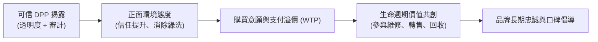

# 永續行銷與循環經濟 (Sustainable Marketing & Circular Economy)

## 概念定義
**永續行銷 (Sustainable Marketing)** 是指在創造客戶價值與建立持久顧客關係的同時，保證並維護自然生態系統與社會福祉的行銷理念。

結合**循環經濟 (Circular Economy)** 的視角，永續行銷超越了傳統單向的「生產 $\to$ 購買 $\to$ 丟棄（Take-Make-Dispose）」線性模式，著眼於**閉環式物質循環（Closed-loop Material Flow）**，促進產品在**使用期的延長維修、再製造（Remanufacturing）與報廢後的再循環**。

---

## 驅動循環行為的理論傳導鏈
根據理性行為理論（Fishbein & Ajzen, 1975）與服務主導邏輯（Vargo & Lusch, 2004），DPP 驅動永續行銷的傳導脈絡如下：

---

## 策略階段演進：從自願期到法規強制期
企業藉由永續資訊工具（如 DPP）獲取競爭優勢的形態，隨法規進程呈現動態兩階段演變（[[source-koukopoulos-lazaris-2026-dpp|Koukopoulos & Lazaris, 2026]]）：

| 發展階段 | 競爭優勢來源 (Competitive Advantage) | 策略重心 |
| :--- | :--- | :--- |
| **階段一：早期自願導入期 (Voluntary Stage)** | **透明度領袖 (Transparency Leadership)**：率先主動揭露資訊，向市場宣告環保承諾，獲取先發差異化溢價。 | 搶佔綠色消費者心智、樹立永續品牌形象 |
| **階段二：全面法規強制期 (Mandatory Stage)** | **超標卓越績效 (Beyond-Compliance Performance)**：當全員皆被強制揭露，優勢轉向「實質績效是否超越法規最低門檻」與「高階數據確信質量」。 | 供應鏈深層減碳、材料創新、循環逆向物流服務 |

---

## 關聯頁面
- 基礎工具：[[digital-product-passport|數位產品護照]]
- 訊號機制：[[signaling-theory-sustainability|永續訊號理論與信任屬性]]
- 商業模式：[[business-model|商業模式]]、[[value-creation-and-capture|價值創造與價值捕獲]]
- 文獻依據：[[source-koukopoulos-lazaris-2026-dpp]]
