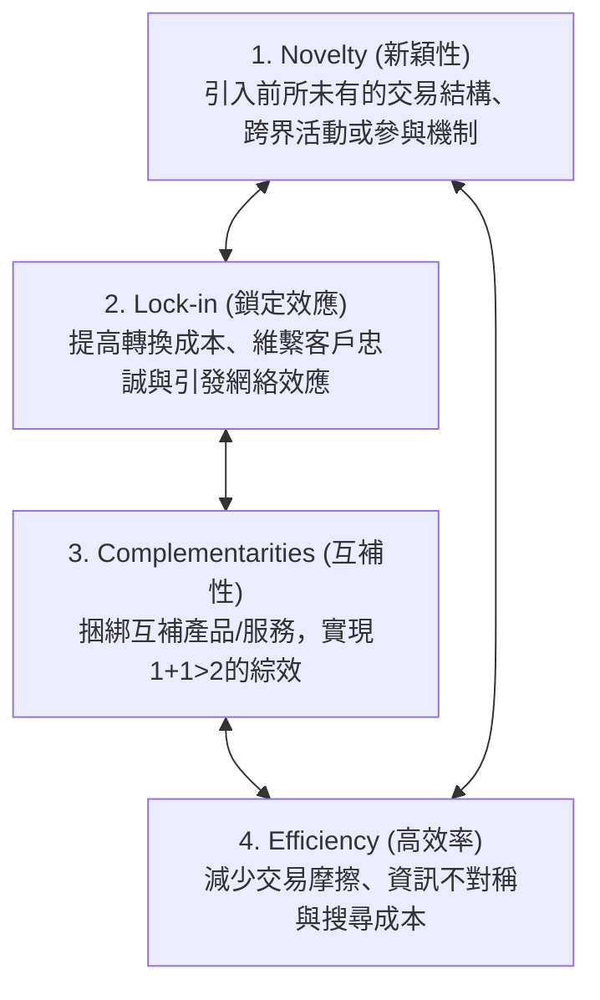

# 價值創造與價值捕獲 (Value Creation and Value Capture)

## 概念定義
- **價值創造 (Value Creation)**：焦點企業與其生態系（客戶、供應商、合作夥伴）所共同產生的整體經濟與社會效益總量。即所有利害關係人從這套商業活動中所獲得之效用提升總和。
- **價值捕獲 (Value Capture / Appropriation)**：焦點企業能夠從上述創造的總價值中，透過營收、定價、利潤率等手段留存給自身的那一部分。

在傳統策略管理理論（如波特競爭優勢與五力模型）中，焦點多集中於「如何在既定蛋糕中分得最大份額（價值捕獲）」。而商業模式文獻（[[source-zott-amit-massa-2010-business-model|Zott, Amit & Massa, 2010]]）則開創性地確立了**價值創造與價值捕獲兼備的雙重視角**：總價值上限決定了企業長期可捕獲價值的極限。

---

## NICE 價值驅動架構 (Amit & Zott, 2001)
Amit & Zott 在分析 150 家企業商業模式後，提出了價值創造的四大核心驅動要素（NICE 模型）。這四者彼此非互斥，且通常**相互強化（Mutually Reinforcing）**：

1. **新穎性 (Novelty)**：熊彼特式的商業模式創新，改變交易參與者、連結方式或利益分配。
2. **鎖定效應 (Lock-in)**：留存用戶與合作夥伴，防止其遷移至競爭對手（如生態系標準、專屬生態配件、社交關係鏈）。
3. **互補性 (Complementarities)**：藉由軟硬整合、第三方外掛或服務搭售，使系統價值大於單一組件價值。
4. **效率性 (Efficiency)**：運用資訊科技大幅精簡流程、提高資訊透明度與縮短交付週期。

---

## 關聯頁面
- 理論本體：[[business-model|商業模式]]、[[activity-system|活動系統觀點]]
- 創新應用：[[business-model-innovation|商業模式創新]]
- 原始文獻：[[source-zott-amit-massa-2010-business-model]]
