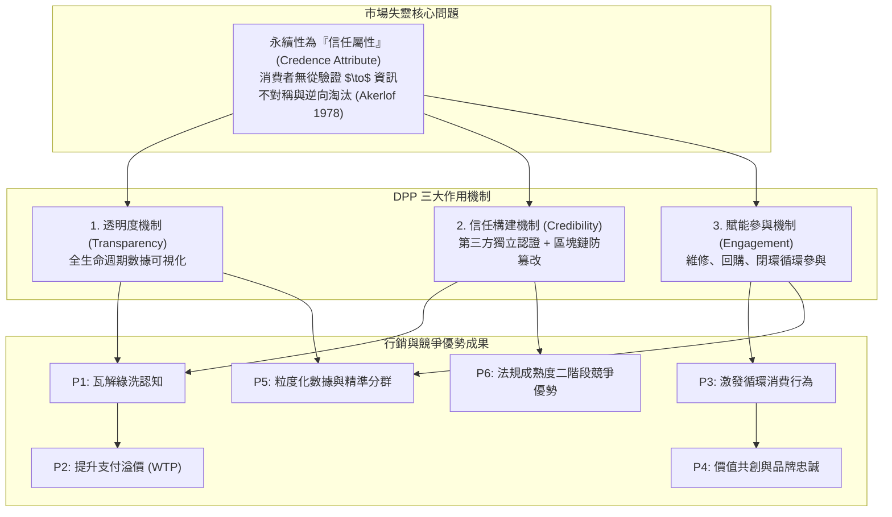

# Digital Product Passport for Sustainable Marketing: Core Propositions and Research Agenda

## 核心摘要（TL;DR）
本篇由 Koukopoulos 與 Lazaris 於 2026 年底發表於《Businesses》期刊的理論概念論文，首度打破過往僅從「供應鏈管理 (SCM)」與「底層技術架構」研究數位產品護照 (DPP) 的視角，轉而從**需求端、消費者行為與永續行銷戰略**建立理論模型。

論文融合**資訊不對稱理論**、**訊號理論**、**理性行為理論**與**服務主導邏輯**，證明永續屬性本質上是消費者無法事前或事後檢驗的「信任屬性 (Credence Attributes)」。只有在經過獨立第三方驗證與審計的前提下，DPP 才能作為高成本的可信訊號（Costly Signal），促成**分離均衡（Separating Equilibrium）**，從根本上瓦解漂綠（Greenwashing），並在法規演進的自願期與強制期階段性驅動企業競爭優勢。

---

## 關鍵貢獻與核心架構

### 1. 核心理論支柱
- **資訊不對稱與屬性三分法（Akerlof 1978; Darby & Karni 1973）**：
  - 搜尋屬性（Search）、體驗屬性（Experience）、**信任屬性（Credence）**。
  - 碳足跡、材料回收率、人道勞動均為信任屬性，買賣雙方資訊極度不對稱，導致市場對真假環保「無差別折價」，引發檸檬市場與漂綠氾濫。
- **訊號理論（Signaling Theory - Spence 1973; Connelly et al. 2011）**：
  - 偽造訊號成本必須高於收益，才能形成**分離均衡（Separating Equilibrium）**。
  - **核心邊界條件（Master Boundary Condition）**：DPP 必須具備「獨立審計與認證」，區塊鏈只能保證資料上鏈後不被篡改，無法驗證上鏈前的源頭真實性。
- **與傳統生態標籤（Eco-Labels）的本質區別**：
  - 傳統生態標籤多為靜態、單一維度、自願申報且容易混淆；
  - DPP 具備法規強制力（EU ESPR）、動態單品追溯（Serialized Item-level）、涵蓋全生命週期，且揭露底層完整數據。

### 2. 六大核心命題 (P1 ~ P6)
1. **P1 (透明度與消減綠洗)**：獨立驗證的 DPP 顯著降低漂綠認知，提高品牌真實度。
2. **P2 (公信力與支付溢價 WTP)**：真實驗證提升消費者對永續產品的支付意願（WTP Premium）與購買意向。
3. **P3 (賦能與循環參與)**：DPP 賦予消費者產品生命週期知識，驅動使用期維修、二手轉售與報廢回收。
4. **P4 (價值共創與品牌擁護)**：消費者透過回收與數據回饋參與價值共創（Vargo & Lusch 2004），強化品牌忠誠。
5. **P5 (行為數據與精準行銷)**：DPP 互動產生微觀行為數據，助力精準綠色市場分群（受隱私與分析能力調節）。
6. **P6 (法規成熟度二階段競爭優勢)**：
   - **自願導入期**：早期採用者享有「透明度領袖」之差異化優勢；
   - **法規強制期**：當全員皆備 DPP，競爭優勢轉移至「超越法規最低門檻的高標準績效（Beyond-Compliance）」與「數據驗證質量」。

---

## 關聯概念與實體
- 核心概念：[[digital-product-passport|數位產品護照 (DPP)]]、[[signaling-theory-sustainability|永續訊號理論與信任屬性]]、[[sustainable-marketing-circular-economy|永續行銷與循環經濟]]、[[value-creation-and-capture|價值創造與價值捕獲]]、[[business-model|商業模式]]
- 來源文件：[[raw/papers/digital-product-passport-sustainable-marketing-2026.md]]
