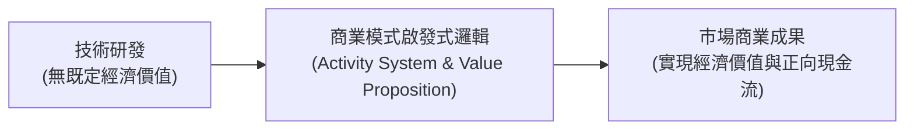

# 商業模式 vs 競爭策略 vs 技術創新：文獻綜述與本質辨析

## 研究問題與核心命題
在管理學界與實務界，「商業模式 (Business Model)」、「競爭策略 (Competitive Strategy)」與「技術創新 (Technology & Innovation)」經常被混用或視為同義詞。

根據 [[source-zott-amit-massa-2010-business-model|Zott, Amit & Massa (2010)]] 對 1975~2009 年文獻的系統性綜述，這三者在**分析視角、核心目標、關鍵機制以及所屬決策層級**上有著清晰的本質區別。它們是**互補關係（Complements），而非替代關係（Substitutes）**。

---

## 核心維度橫向對比
| 維度 | 電子商務與營運視角 (COO) | 競爭策略視角 (CEO) | 商業模式架構視角 (跨邊界系統) | 技術與創新管理視角 (CTO) |
| :--- | :--- | :--- | :--- | :--- |
| **主要關注** | 資訊流、交易技術、支付與交付通道 | 市場定位、對抗競爭對手、構建護城河 | 跨邊界活動系統、價值主張、利害關係人生態 | 技術突破、專利、R&D 研發管線 |
| **價值導向** | 交易效率與數位化轉換 | **價值捕獲 (Value Capture)**：如何確保企業獲取超額利潤 | **價值創造與捕獲並重 (Dual Focus)**：如何做大生態總價值並合理分配 | 潛在價值釋放：將研發轉化為可用產品 |
| **分析單位** | IT 系統 / 交易通道 | 單一企業與特定產業環境 | **跨越企業與外部網絡的活動系統** | 單項技術 / 產品原型 |
| **競爭觀點** | 數位工具賦能 | 零和博弈、差異化 vs 成本領導 (Porter) | 合作共贏、互補性網絡、生態演化 | 技術效能指標（速度、精準度、成本） |
| **代表文獻** | Timmers (1998)、Osterwalder (2004) | Porter (1985, 1996) | [[source-zott-amit-massa-2010-business-model\|Zott et al. (2010)]]、Amit & Zott (2001) | Chesbrough & Rosenbloom (2002) |

---

## 關鍵辨析與理論洞察

### 1. 商業模式與策略的關係（建築師比喻）
Shafer, Smith & Linder (2005) 提出了一個生動的比喻：
- **策略 (Strategy)**：相當於屋主與建築師溝通後產生的「客製化住宅概念藍圖與生活願景」（定義想去哪裡、如何定位）；
- **商業模式 (Business Model)**：相當於建築師依據該藍圖所繪製出的「精密施工平面圖（Detailed Floor Plan）」，規定了每一道牆、門窗、電路與活動動線的安排。
- Casadesus-Masanell & Ricart (2010) 進一步總結：商業模式是「企業已實現策略（Realized Strategy）的具體投射」。

### 2. 商業模式與技術的關係（Chesbrough 轉換邏輯）
- **技術本身沒有既定經濟價值**：未經由商業模式媒介，最尖端的技術（例如 Xerox PARC 早期開發的圖形化介面與以太網）也可能在商業上一敗塗地。
- **商業模式是「啟發式轉換邏輯 (Heuristic Logic)」**：它搭起了研發實驗室與市場需求之間的橋樑。正如 Chesbrough (2007) 所斷言：「**平庸技術搭配卓越商業模式，遠勝於頂尖技術搭配平庸商業模式**」。

---

## 參考文獻與關聯頁面
- 基礎概念：[[business-model|商業模式]]、[[activity-system|活動系統觀點]]、[[value-creation-and-capture|價值創造與價值捕獲]]、[[business-model-innovation|商業模式創新]]
- 來源文獻：[[source-zott-amit-massa-2010-business-model]]
