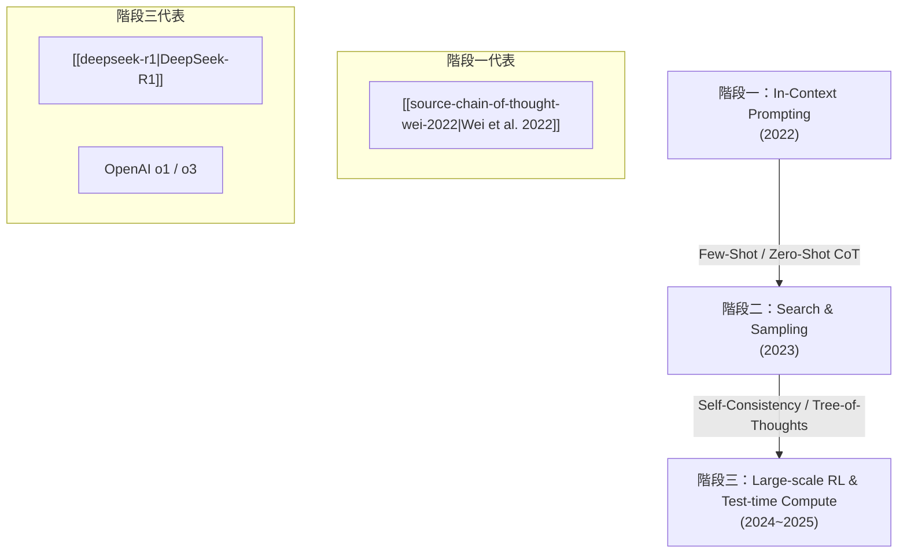

# 大模型推理機制演進史：從 Prompting (CoT) 到 Test-time Compute / RL

## 研究問題與核心觀點
傳統預訓練大模型在 System 1（直覺、快速、下一個 Token 預測）表現優異，但缺乏人類類似 System 2（深思熟慮、回溯檢驗、多步驟推導）的能力。

近年來大模型推理技術的演變，經歷了從「提示工程誘導」到「架構搜尋」，再到「強化學習自主湧現」的三大典範轉移。

## 演進三大階段分析

### 1. 提示誘導時代 (Prompting Phase)
- **代表工作**：[[source-chain-of-thought-wei-2022|Chain-of-Thought (Wei et al., 2022)]]、Zero-Shot CoT (Kojima et al.)。
- **核心思維**：透過提示詞解鎖預訓練模型中已隱含的推導能力。
- **局限**：一旦中間推導出現錯誤，模型無法自動回頭修正（Lack of self-correction），誤差會沿著生成路徑累積放大。

### 2. 搜尋與外部取樣時代 (Sampling & Search Phase)
- **代表工作**：Self-Consistency (Wang et al., 2022)、Tree of Thoughts (Yao et al., 2023)。
- **核心思維**：在生成時採樣多條路徑，結合蒙地卡羅樹搜尋 (MCTS) 或投票機制提升穩健性。
- **代價**：推理 Token 消耗極大，且依賴外部啟發式評估函數（Value Function）。

### 3. 自主強化學習與測試期計算擴展 (RL & Test-time Scaling Phase)
- **代表工作**：OpenAI o1 / o3、[[deepseek-r1|DeepSeek-R1 (2025)]]。
- **核心特徵**：
  - **思考長度自我調整**：模型根據問題難度動態分配 Test-time compute（思考時間）。
  - **湧現行為**：模型學會自我反思（"Wait, let me double check..."）、多路徑嘗試、發現死胡同主動回溯。
  - **訓練革新**：以純規則獎勵（Rule-based Reward：如代碼運行正確性、數學答案符號匹配）取代不穩定的神經網絡獎勵模型，解決獎勵黑客（Reward Hacking）問題。

## 橫向對比總結
| 特性維度 | 階段一 (Prompting CoT) | 階段二 (Search / Sampling) | 階段三 (Test-time RL / R1) |
| :--- | :--- | :--- | :--- |
| **推理機制** | 依賴 Prompt 示範 | 外部演算法調度 | 模型內部原生湧現 (Native) |
| **自我除錯能力** | 無（單向向前） | 有限（透過評估器過濾） | 強（主動驗證與重新推導） |
| **訓練需求** | 零微調 | 零微調或獎勵模型 | 大規模強化學習 (RL) |
| **標誌性成果** | [[source-chain-of-thought-wei-2022]] | Tree of Thoughts | [[deepseek-r1]] |

## 參考文獻與關聯頁面
- [[chain-of-thought]]
- [[source-chain-of-thought-wei-2022]]
- [[deepseek-r1]]
